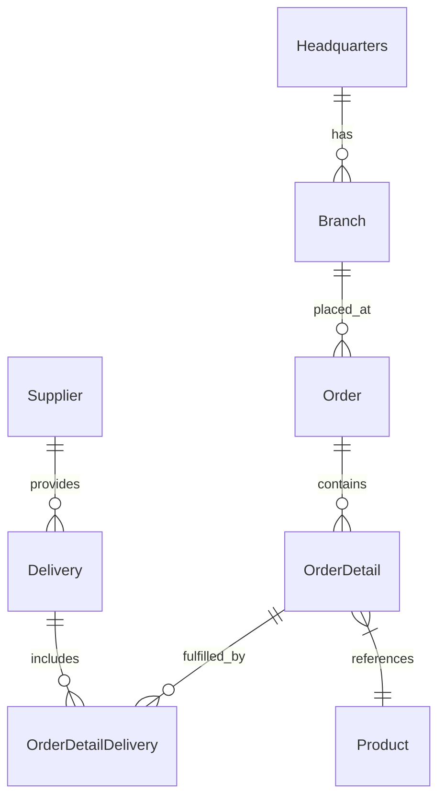

# 🚀 OctoCAT Supply: The Ultimate GitHub Copilot Hands-On Demo v2.0


Welcome to the OctoCAT Supply Website - your go-to demo for showcasing the incredible capabilities of GitHub Copilot, GHAS, and the power of AI-assisted development!

OctoCAT Supply combines a React storefront and product administration UI with an Express REST API for products, suppliers, orders, branches, headquarters, and deliveries. It is a hands-on learning project, not a production-ready commerce system.

## 🚀 Getting Started

### Prerequisites

- Node.js 18 or later and npm
- Git
- VS Code with GitHub Copilot for the hands-on exercises (optional for running the app)

### Run locally

Clone the repository, open its root directory, and run:

```bash
git clone https://github.com/nkusakula/GitHubcopilot_customized.git
cd GitHubcopilot_customized
npm install
npm run dev
```

The root project uses npm workspaces, so one installation installs dependencies for both the API and frontend.

| Service | Local URL |
| --- | --- |
| Storefront | http://localhost:5137 |
| API products | http://localhost:3000/api/products |
| Swagger UI | http://localhost:3000/api-docs |
| OpenAPI JSON | http://localhost:3000/api-docs.json |

Keep the development command running while using the app. The frontend expects the local API on port `3000`; its development server uses port `5137`.

**Demo limitations:** API data is seeded in memory and resets when the API restarts. Login is simulated in the browser: any nonempty email and password signs in, and an email ending in `@github.com` enables the admin UI. This is not real authentication or API authorization; do not use real credentials or sensitive data.

## ✨ What Makes This Demo Special

This isn't just another demo app - it's a carefully crafted showcase that demonstrates the full spectrum of GitHub's AI capabilities:

- 🤖 **Copilot Agent Mode & Vision** - Watch Copilot understand UI designs and implement complex features across multiple files
- 🎭 **MCP Server Integration** - Demonstrate extended capabilities with Playwright for testing and GitHub API integration
- 🧪 **Test Generation** - Exhibit Copilot's ability to analyze coverage and generate meaningful tests
- 🔄 **CI/CD & IaC** - Generate deployment workflows and infrastructure code with natural language
- 🎯 **Custom Instructions** - Show how Copilot can be tailored to understand internal frameworks and standards
- 📜 **Custom Prompt Files** - Automate repetitive tasks and documentation updates with ease

---

## 💻 Hands-On Scenarios

**Using GitHub Copilot Free?** Perform the activities in your local IDE with a model available on your plan.

1. **GUIDED HANDS-ON: Create Custom Instructions and a Custom Prompt File**
   This activity will be performed together as a group.
   - Use GitHub Copilot Ask Mode and Agent to ask Copilot about the API of the project or any other question about your repo and run the project to see it live.
      - Sample Prompt: `Please give me details about the API of this project.`
      - Sample Prompt: `Are there any core features missing in my project?`
   - Use Agent mode to have GitHub Copilot build and run the existing implementation of the Supply Chain store.
      - Sample Prompt: `Please build and run my project so that I can see its existing state.`
         - Review the existing store. 
   - Use GitHub Copilot to update or create the custom instructions for the OctoCAT Supply project.
      - Use the `Gear` icon in the GitHub Copilot Chat window to select the `Generate Agent Instructions`  prompt. 
         - Create a generic (project wide) GitHub Copilot Instructions file.
            - Hint: This file should be in the base directory of the `.github` folder and have the name `copilot-instructions.md`.
         - Create an API specific GitHub Copilot Instructions file using the same process as before.
            - Hint: This file should be in the `.github/instructions` directory and have a name that resembles `API.instructions.md`
            - Sample Prompt: `Please create an API Specific custom instructions set and save in  #API.instructions.md `
   - Ask GitHub Copilot questions about your project and discover the use of the `Custom Instructions` files that have been created. 
      - How does your response compare to before?
   - Review Existing GitHub Copilot Prompt files to learn about how they can help speed up your workflow.  Execute one if you'd like.
---
2. **GUIDED HANDS-ON: Review and Create a Custom Agent**
   This activity will be performed together as a group.
   - Review the [Implementation Ideas custom agent](./.github/agents/ImplementationIdeas.agent.md).
   - Create a custom agent for the OctoCAT Supply project if you would like.
---
3. **Requirements Specifications and Agentic Implementation** 
   - Use the previously reviewed custom agent to define features and create an implementation plan.
      - Use [MonaFigurine.png](./docs/design/MonaFigurine.png) to create a new product offering on the website.
          - Sample Prompt: `Using the image #file:MonaFigurine.png, add a new product offering to the OctoCAT Supply website. Price is $32.99, SKU is MONA-001, and description is "A beautiful handcrafted figurine inspired by the Mona Lisa."`
      - Generate UI components from design mockups (using Copilot Vision) and Generated Implementation Plan.
      - Review the generated changes. If you use a pull request workflow, review and merge the pull request before continuing.
   - Use GitHub Copilot Agent mode to create a cart page and cart icon.
      - Synchronize your branch with the latest main branch.
      - Start a new chat using Agent mode and select an available model that supports it.
      - Drag [cart.png](./docs/design/cart.png) into the chat window.
      - Ask Copilot to implement a simple cart icon and cart page that displays the items in the cart.

---
4. **Test Generation and Coverage Improvement**
   - Analyze existing test coverage using `Ask` Mode. 
       - Sample Prompt:  `Please analyze my current test coverage and identify any missing test cases.`
   - Generate unit and integration tests with Copilot
      - Hint: Use the [Unit Test Coverage prompt](./.github/prompts/Unit-Test-Coverage.prompt.md) to generate unit tests for the Product and Supplier routes.
   - Improve coverage based on analysis
   - BONUS: Ask GitHub Copilot to exercise the running storefront using the Playwright MCP server. Use Vitest for API unit and integration tests.
---
5. **Documentation Update**
   - Use GitHub Copilot Internal Prompting to create a custom prompt file for the OctoCAT Supply project to update all existing documentation for the project.
       - Hint: Use the "Prompt Files" prompt to create a custom prompt file for the OctoCAT Supply project.
       - Sample Prompt: `Complete the prompt file to update the documentation of this project or the specified file mentioned by the user.  Only update the prompt file, do not update any documentation.`
    - Execute the custom prompt file to update the intended documentation.
        - Hint: Invoke the prompt with its slash command and specify `README.md` and `docs/architecture.md` if you only want those files updated.

---

## 🏗️ Architecture

The application is built using modern TypeScript with a clean separation of concerns:



### Tech Stack
- **Frontend**: React 18+, TypeScript, Tailwind CSS, Vite
- **Backend**: Express.js, TypeScript, OpenAPI/Swagger
- **Testing**: Vitest and Supertest for the API
- **Container support**: API Dockerfile

### Repository Layout

| Directory | Contents |
| --- | --- |
| `api/` | Express API, entity models, seeded data, route tests, and Dockerfile |
| `frontend/` | React storefront, demo login, product administration, and static assets |
| `docs/` | Architecture, build instructions, demo guides, and design mockups |
| `.github/` | Copilot custom agent, prompt files, and workflow configuration |
| `.vscode/` | Build tasks, debug configuration, and optional MCP servers |

## 🛠️ Development Commands

Run these commands from the repository root after installing dependencies:

| Command | Purpose |
| --- | --- |
| `npm run dev:api` | Start only the API |
| `npm run dev:frontend` | Start only the frontend |
| `npm run build` | Compile the API and build the frontend |
| `npm run test:api` | Run API tests in watch mode |
| `npm run test --workspace=api -- --run` | Run API tests once |
| `npm run test:coverage --workspace=api` | Run API tests once with coverage reports |
| `npm run lint` | Lint the frontend |

The frontend does not currently define a test script; use the API-specific commands above instead of the root `npm test` command.

Or use the VS Code tasks:
- `Cmd/Ctrl + Shift + P` -> `Tasks: Run Task` -> `Build All`
- Use the Debug panel to run `Start API & Frontend`

## 🛠️ MCP Server Setup (Optional)

The repository includes GitHub and Playwright MCP server definitions in [`.vscode/mcp.json`](./.vscode/mcp.json). They extend Copilot's tools and are not required to run the application.

In the VS Code command palette, select `MCP: List Servers`, choose `playwright` or `github`, and start the server. Review any trust prompts and complete authentication if requested. Start the app before using Playwright to interact with it.

## 📚 Documentation

- [Detailed Architecture](./docs/architecture.md)
- [Build Instructions](./docs/build.md)
- [Demo Script](./docs/demo-script.md)
- [Security Policy](./SECURITY.md)

---

## 🙌 Acknowledgements
**GitHub Universe 2025 Demo Contributors:** Dustin Ellis (@ellisd4), Harald Kirschner (@digitarald), Joel Norman (@microsoftnorman)

**GitHub Universe 2025 Demo Testers:** Tina Saulsberry (@Snuckles2)


*This entire project, including the hero image, was created using AI and GitHub Copilot! Even this README was generated by Copilot using the project documentation.* 🤖✨
